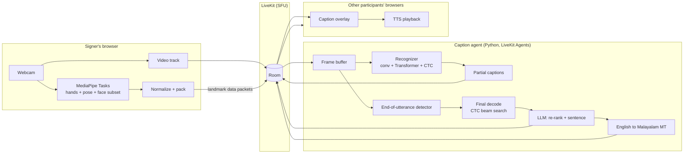
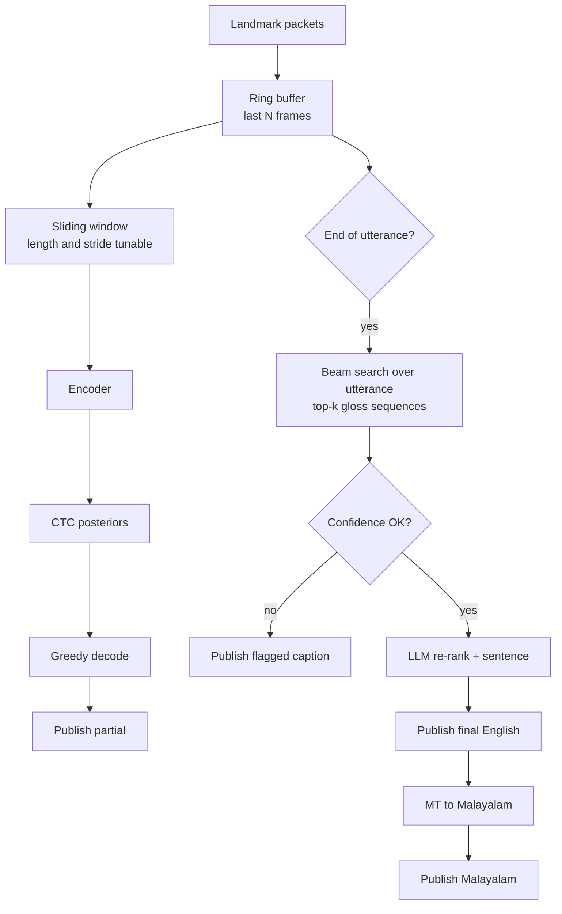
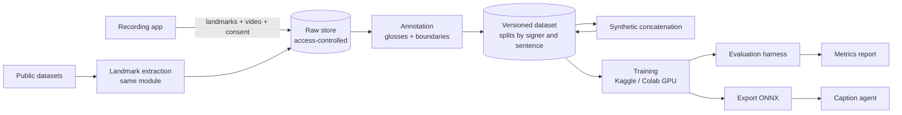

# SignBridge Meet: Architecture

| | |
|---|---|
| Version | 0.1 (draft) |
| Date | 2026-10-20 |
| Companion doc | [PRD.md](PRD.md) |

Values marked **TBD** or "tunable" are starting points to be set by measurement, not fixed design numbers.

---

## 1. Design principles

1. **Landmarks, not pixels.** Recognition works on MediaPipe landmarks. Raw video never goes to the recognition service.
2. **Integrate everything that is not the core problem.** LiveKit for media, existing MT for Malayalam, existing TTS, an existing LLM for sentence formation.
3. **One preprocessing module everywhere.** The recording app, training pipeline and live system share the same normalization code. This avoids train/serve skew.
4. **Measure every stage.** Each hop carries timestamps so latency can be broken down.
5. **Fail visibly.** Low confidence produces a flagged caption or nothing, never a confident wrong guess.

## 2. System context



The caption agent joins each room as a hidden participant. It subscribes to landmark data from signers and publishes caption messages back to the room. All participants receive captions through LiveKit, so the frontend needs no separate caption server connection.

## 3. Components

### 3.1 Web client

| Item | Choice |
|---|---|
| Framework | React + TypeScript, LiveKit React components |
| Landmarks | MediaPipe Tasks Vision for web (Hand Landmarker + Pose Landmarker, or Holistic Landmarker if it performs well enough on target laptops) |
| Execution | WASM with GPU delegate where available, CPU fallback |
| Capture rate | 15 to 30 FPS (tunable; measure CPU load on target laptops) |

Responsibilities:

- Framing guide and tracking-quality indicator before and during the call.
- Landmark extraction, normalization (section 4), packing and sending.
- Caption overlay with partial/final states, language switch, size and contrast settings.
- Optional TTS playback of final captions.
- Client-side timestamps for latency measurement.

### 3.2 LiveKit

Self-hosted LiveKit server (Docker) for development. LiveKit Cloud is an option for the demo (decision TBD). Handles auth tokens, rooms, audio/video, chat, screen share and data packets. We write no signaling or SFU code.

A small backend (FastAPI or Node, team's choice) issues LiveKit access tokens and manages users and meetings.

### 3.3 Caption agent

A Python worker built on LiveKit Agents. One agent instance per room; one pipeline per active signer.



Sub-modules:

| Module | Description |
|---|---|
| Ring buffer | Holds recent normalized frames per signer. Max length bounded (tunable, a few hundred frames). |
| End-of-utterance detector | Rule-based first: both wrists below a rest line and low hand velocity for a set duration (tunable). Can be replaced by a learned head later. |
| Recognizer | Landmark encoder + CTC head (section 5). Runs on CPU via ONNX Runtime. |
| Partial decoder | Greedy CTC on the latest window. Uses an "in-progress" state so a sign is not committed until stable (the `<inc>` idea from the plan). |
| Final decoder | CTC beam search over the whole utterance, returning top-k gloss sequences with scores. |
| Sentence former | LLM picks the most plausible hypothesis given recent captions and writes one English sentence (section 6). |
| Template fallback | Retrieval over the 30 to 50 templates. Used as a baseline and as a fallback mode. |
| MT | IndicTrans2-class English to Malayalam model, run as a local service or library. |

### 3.4 TTS

Runs after a final caption. Options in order of effort: browser Web Speech API (quality varies by OS, especially for Malayalam), a hosted TTS service with Malayalam support, or an open Indic TTS model. Choice TBD after listening tests.

## 4. Landmark format and preprocessing

### 4.1 Points

| Group | Points | Source |
|---|---|---|
| Left hand | 21 | Hand Landmarker |
| Right hand | 21 | Hand Landmarker |
| Upper-body pose | 25 (BlazePose indices 0 to 24) | Pose Landmarker |
| Face subset | Lips and eyebrows, exact indices TBD | Face / Holistic landmarker |

Coordinates: x, y for all points. Hand z is optional and kept only if it helps on the validation set.

### 4.2 Normalization (shared module)

1. Origin at the shoulder midpoint.
2. Scale by shoulder width.
3. Missing hand: zero-fill plus a presence flag per hand. Short gaps (a few frames) filled by interpolation.
4. Optional derived features: frame-to-frame velocity, fingertip distances.
5. Hand dominance: training augmentation mirrors x and swaps left/right channels.

The same module is packaged once and used by the browser (TypeScript port, tested against the Python version on fixed inputs), the training pipeline and the agent.

### 4.3 Wire format

Frames are batched (for example every 100 ms, tunable) and sent as LiveKit data packets on a dedicated topic.

```text
LandmarkPacket {
  v: 1
  signer_id: string
  seq: uint32              // packet sequence number
  t_capture_ms: [uint64]   // per-frame capture time
  fps: float
  presence: [[uint8;2]]    // per frame: left, right hand present
  data: float16[frames][points][2]   // binary, row-major
}
```

Binary encoding (MessagePack or a raw typed array with a small header) is preferred over JSON for size.

### 4.4 Caption message

```text
Caption {
  v: 1
  id: string               // stable per utterance; partials and final share it
  signer_id: string
  kind: "partial" | "final" | "flagged" | "retracted"
  glosses: [string]
  text_en: string | null
  text_ml: string | null
  confidence: float
  t_utterance_start_ms: uint64
  t_utterance_end_ms: uint64 | null
  timings: { recognize_ms, llm_ms, mt_ms }   // for diagnostics
}
```

The client replaces the partial with the final when they share an `id`.

## 5. Recognition model

### 5.1 Architecture

Starting point: the design family used by top solutions in Google's 2023 Kaggle sign language competitions (landmark input, small models, CTC for continuous recognition). Reused code must have its origin and licence recorded.

```text
input  (T, F)                    T frames, F features
  -> linear projection to d_model
  -> [ depthwise Conv1D block -> Transformer block ] x L
  -> linear -> softmax over (gloss vocabulary + blank)
  -> CTC loss
```

| Hyperparameter | Starting value |
|---|---|
| d_model | 192 to 256 |
| Blocks (L) | 4 to 8 |
| Parameters | Low millions |
| Attention | Local / windowed for streaming, full for final pass (to compare) |

All of these are tunable. Keep the model small enough for CPU inference within the latency budget.

### 5.2 Training stages

1. **Isolated pretraining.** Classify isolated signs (INCLUDE, plus our clips). Pooled head on the same encoder.
2. **Continuous CTC.** Fine-tune on continuous data: ISL-CSLTR, our recordings, synthetic concatenations.
3. **Domain fine-tune.** Final pass on our domain sentences only.

Augmentation: random rotation, scale and shear; temporal resampling (speed change); frame drop; hand and finger dropout; small Gaussian noise; mirror with channel swap.

### 5.3 Baseline

Template retrieval: pool encoder output over the utterance, nearest neighbour against template embeddings, with slots where needed. Reported alongside the CTC + LLM pipeline.

## 6. Sentence formation (LLM)

### 6.1 Inputs and outputs

Input: top-k gloss hypotheses with scores, the last few final captions, domain description and few-shot examples.
Output: index of the chosen hypothesis plus one English sentence, as structured JSON.

### 6.2 Rules in the prompt

- Use only the meaning in the chosen glosses. Do not add facts, names or numbers.
- If no hypothesis makes sense, return `null` so the caption is flagged.
- Keep sentences short and plain.

### 6.3 Model options

| Option | Pros | Cons |
|---|---|---|
| Hosted API, small fast model | No GPU, fast to try | Network latency, cost, sends caption text to a third party (needs review) |
| Self-hosted small open model (1 to 3B), LoRA fine-tuned | Private, offline, fixed cost | Needs a GPU or slower CPU inference, more setup |

Plan: prototype with the hosted option, build the evaluation set, then decide. Both sit behind one interface so they can be swapped.

### 6.4 Also used offline

The LLM generates gloss/English pairs to augment training data for the sentence step. An ISL-fluent reviewer checks a sample, since LLMs do not reliably know ISL grammar.

## 7. Latency budget

Each message carries timestamps, so every stage below is logged.

| Stage | Budget |
|---|---|
| Capture + landmark extraction (client) | TBD |
| Transport to agent | TBD |
| Window inference (partial) | TBD |
| End-of-utterance wait | Tunable rest duration |
| Beam search + LLM | TBD |
| MT | TBD |
| Transport to viewers + render | TBD |

Fill this table from Phase 1 measurements. Report partial and final latency separately.

## 8. Data and training pipeline



| Concern | Choice |
|---|---|
| Training framework | PyTorch |
| Experiment tracking | Weights & Biases (or MLflow) |
| Dataset versioning | DVC or versioned folders with manifest files |
| Export | ONNX, run with ONNX Runtime in the agent |
| Evaluation | Gloss WER, BLEU, chrF, template accuracy, hallucination review, latency |

Natural-signing test sets are never used for training or tuning, and never mixed with synthetic data.

## 9. Deployment

| Environment | Setup |
|---|---|
| Local dev | Docker Compose: LiveKit server, token backend, caption agent, MT service; frontend via Vite dev server |
| Demo | Single Linux VM or laptop running the same compose file, or LiveKit Cloud + agent on a VM (TBD) |

No GPU required for inference with the landmark model. A GPU helps only if the self-hosted LLM option is chosen.

## 10. Privacy and security

- Raw video goes only through LiveKit to participants, as in any meeting. The caption agent receives landmarks, not video.
- Landmarks and captions are kept in memory only, unless the user opts in to saving a transcript or donating debug data.
- Recording-app data is stored with access control and linked to a consent record.
- If a hosted LLM API is used, caption text leaves our infrastructure. This needs review (PRD section 13).
- LiveKit tokens are short-lived and room-scoped.

## 11. Repository layout (proposed)

```text
signbridge/
  apps/
    web/              React client, caption UI, MediaPipe capture
    recorder/         Data recording app (shares capture code with web)
    backend/          Token issuing, users, meetings
  services/
    caption-agent/    LiveKit Agents worker
    mt/               English to Malayalam service
  packages/
    landmarks-ts/     Normalization, TypeScript
    landmarks-py/     Normalization, Python (reference implementation)
    capture-web/      Browser webcam + MediaPipe capture, shared by web and recorder
    schemas/          Wire formats (LandmarkPacket, Caption), TS and Python
  ml/
    data/             Manifests, split definitions (no raw data in git)
    train/            Training code and configs
    eval/             Evaluation harness
  infra/
    docker-compose.yml
  docs/
    PRD.md
    architecture.md
```

## 12. Alternatives considered

| Alternative | Why not (for MVP) |
|---|---|
| RGB video models (3D-ResNet, MC3_18) | Need a GPU server and raw video upload; do not fit landmark streaming |
| CDCM / BART consistency loss | Research-level training effort; LLM re-ranking gives similar disambiguation more cheaply. Kept as future work. |
| Jitsi | Workable, but LiveKit Agents gives a ready way to add a server-side participant that publishes captions |
| Custom WebRTC + WebSocket server | Time spent on infrastructure that is not the project's contribution |
| Train a seq2seq decoder from scratch | Small dataset; high risk of overfitting and misleading scores |
| General multimodal video LLM end to end | Unknown ISL accuracy, cost and latency. Worth testing as an evaluation baseline only. |

## 13. Stretch: in-browser inference

Move the recognizer into the signer's browser with ONNX Runtime Web. The agent then receives glosses or text instead of landmarks and only runs the LLM and MT steps. Benefits: no recognition server load, and landmarks never leave the device. Do this only after the server-side version is evaluated, and confirm the browser output matches the server output on the same inputs.

## 14. Open decisions

1. Holistic Landmarker vs. separate hand and pose landmarkers (measure FPS and CPU on target laptops).
2. Face landmark subset.
3. Window length, stride and rest duration for the end-of-utterance detector.
4. Hosted vs. self-hosted LLM.
5. TTS option.
6. Self-hosted LiveKit vs. LiveKit Cloud for the demo.
